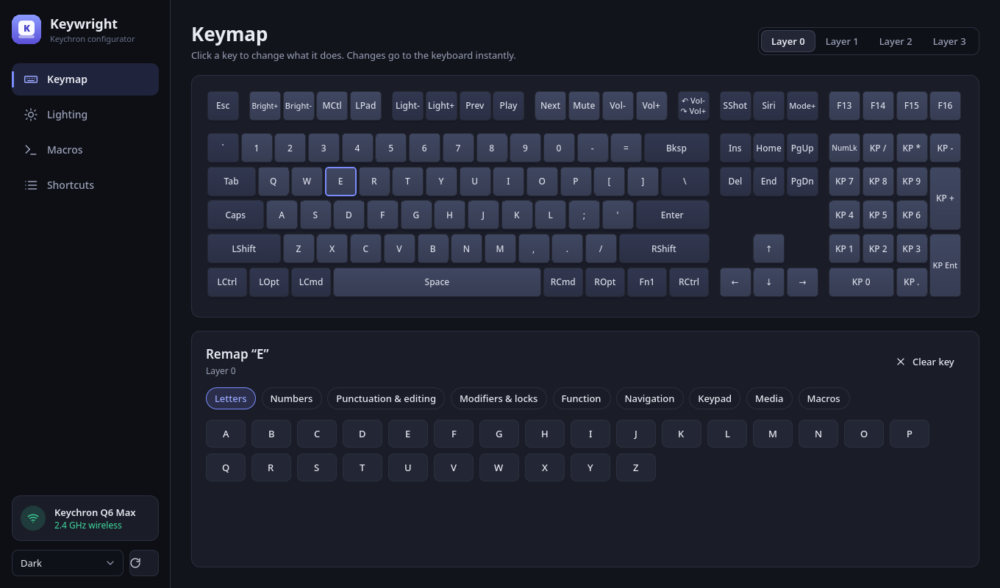
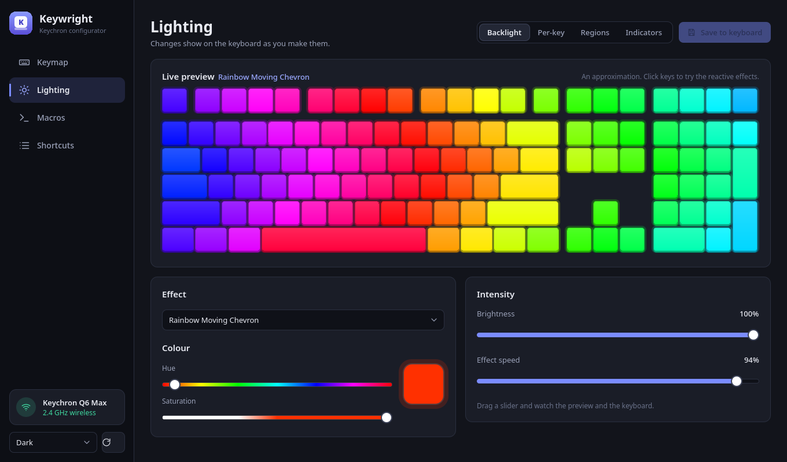
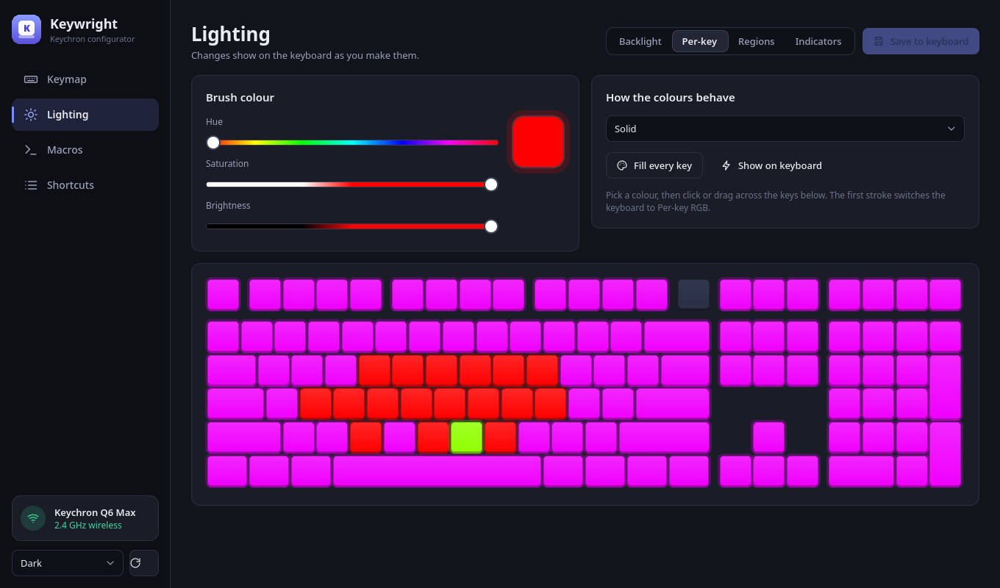
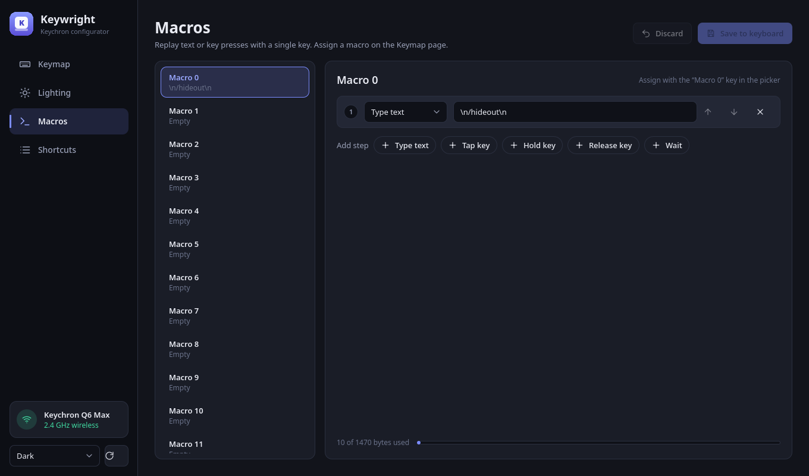
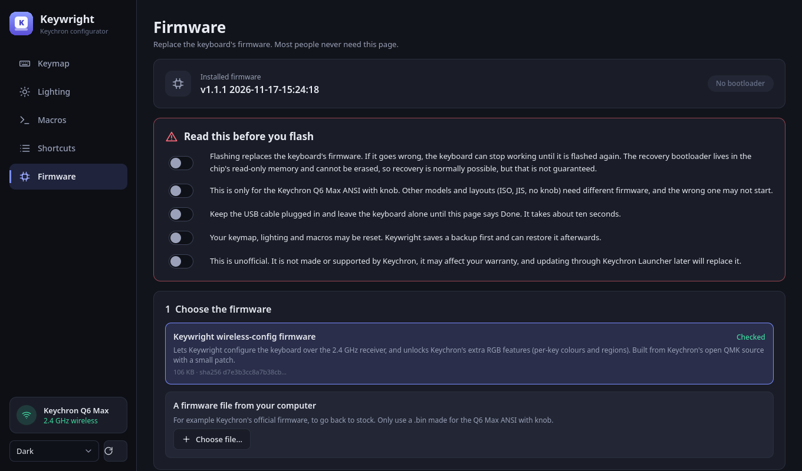

<p align="center"></p>

<h1 align="center">Keywright</h1>

<p align="center">
  A fast, native desktop app for configuring the <b>Keychron Q6 Max</b>.<br>
  Keymap, knob, RGB and macros, over USB or <b>2.4&nbsp;GHz wireless</b>. No browser required.
</p>

<p align="center">
  <a href="https://github.com/shatteredeagle/keywright/actions/workflows/ci.yml"></a>
  <a href="https://github.com/shatteredeagle/keywright/releases/latest"></a>
  
  
</p>

<p align="center"></p>

> **Unofficial.** Keywright is not made, endorsed or supported by Keychron. It speaks the keyboard's open VIA/QMK configuration protocol.

## Why

Keychron's configurator is a web app that needs Chromium and a cable. Keywright is a real desktop application: it starts instantly, follows your system theme, works offline, and, with the bundled firmware, can configure the keyboard **wirelessly through the 2.4&nbsp;GHz receiver**.

## What it does

| | |
|---|---|
| **Keymap** | Remap any key on all four layers with a searchable picker. The knob is a key too: set what turning it left and right does, per layer. |
| **Lighting** | Backlight effect, colour, brightness and speed with a **live animated preview** that follows the sliders. Per-key painting (click and drag), mixed-effect regions, lock-key indicators. |
| **Macros** | Sixteen slots: type text, tap, hold and release keys, add waits. Shows how much macro memory is left. |
| **Shortcuts** | A readable cheat sheet of everything the Fn layers do. |
| **Firmware** | Flash the wireless-config firmware, or any `.bin`, with backups, checks and verification. |
| **Everything else** | Light, dark and system themes. Reads and writes straight to the keyboard, so there is no "apply" step except saving lighting. |

<table>
  <tr>
    <td></td>
    <td></td>
  </tr>
  <tr>
    <td></td>
    <td></td>
  </tr>
</table>

## Quick start

1. **Download** the package for your system from the [latest release](https://github.com/shatteredeagle/keywright/releases/latest).
2. **Install**
   - **Linux**: `chmod +x Keywright-*.AppImage`, then run it. To let it open the keyboard without root, install the udev rule once:
     ```sh
     sudo install -Dm644 70-keywright.rules /etc/udev/rules.d/70-keywright.rules
     sudo udevadm control --reload-rules
     ```
     then unplug and replug the keyboard.
   - **macOS** (Apple silicon): open the `.dmg`, drag Keywright to Applications. The app is unsigned, so the first time use right-click, **Open**. Allow **Input Monitoring** when macOS asks.
   - **Windows**: unzip and run `keywright.exe`.
3. **Plug the keyboard in** with its USB cable. Keywright finds it and shows the keymap. Click a key to remap it.

That is all you need for keymap, knob, lighting and macros over the cable.

## Configuring over 2.4 GHz wireless

The stock Q6 Max firmware only accepts configuration over USB. Keychron's open source already contains the code that would pass it through the 2.4&nbsp;GHz receiver, but it is switched off. Keywright ships a firmware build with it switched on (plus Keychron's extra RGB features, which newer sources enable).

1. Open the **Firmware** page and read the warnings.
2. Follow the four steps: choose the bundled firmware, back up, enter the bootloader, flash.
3. Afterwards, slide the keyboard to **2.4G**. Keywright finds it through the Keychron Link receiver and shows "2.4 GHz wireless" in the sidebar.

Bluetooth cannot be used for configuration. The wireless radio chip's Bluetooth profile has no channel for it, and no firmware change can add one.

## Firmware flashing: read this

> [!CAUTION]
> Flashing replaces your keyboard's firmware. Done wrongly, the keyboard can stop working until it is flashed again.

- The recovery bootloader lives in the chip's read-only memory and **cannot be overwritten**, so a bad flash is normally recoverable by entering bootloader mode again. That is normally, not always.
- **Only for the Keychron Q6 Max ANSI with knob** (STM32F401). ISO, JIS and other models need different firmware.
- Keep the cable plugged in until the page says **Done**. Flashing takes about ten seconds.
- Your keymap, lighting and macros may be reset. The Firmware page saves a backup first and can restore it.
- Updating through Keychron Launcher later replaces this firmware. Flash it again to get wireless configuration back.
- It may affect your warranty. You do this at your own risk.

**Bootloader mode:** slide the mode switch to the middle (Off), unplug the cable, hold **Esc**, plug the cable back in while holding it, and keep holding for two seconds. The keyboard stays dark. That is normal.

**Going back to stock:** download Keychron's official firmware for the Q6 Max ANSI knob from their [firmware page](https://www.keychron.com/pages/firmware-and-json-files-of-the-keychron-qmk-keyboards), then choose it with "A firmware file from your computer" on the Firmware page.

**If it will not start:** enter bootloader mode again and flash again. Keywright verifies every write by reading the firmware back before it lets the keyboard run it.

<details>
<summary>What the bundled firmware changes</summary>

It is [Keychron's `qmk_firmware`](https://github.com/Keychron/qmk_firmware) (branch `2025q3`, commit pinned in [`firmware/build.sh`](firmware/build.sh)) with [one small patch](firmware/q6max-wireless-raw-hid.patch): define `WILRESS_RAW_ENABLE` for the Q6 Max and fix a call in the wireless code that points at a function that no longer exists. Nothing else about typing, lighting or battery behaviour changes. Release builds are made by CI from that source. To reproduce one: `VERSION=dev firmware/build.sh` (needs `arm-none-eabi-gcc`).

</details>

## Supported hardware

| Keyboard | Status |
|---|---|
| Keychron Q6 Max, ANSI, with knob (`3434:0860`) | Supported |
| Keychron Q6 Max ISO / JIS | Not yet (needs its own layout and firmware) |
| Other Keychron / QMK boards | Not supported |

## Troubleshooting

- **"No keyboard found" on Linux**: install the udev rule from Quick start, then replug the keyboard.
- **Nothing shows over 2.4 GHz**: you need the wireless-config firmware (see above), the receiver plugged in, and the mode switch on 2.4G. Typing working does not mean configuration works on stock firmware.
- **macOS asks for permission**: allow Input Monitoring for Keywright in System Settings, Privacy & Security.
- **Windows cannot flash**: install the WinUSB driver for "STM32 BOOTLOADER" with [Zadig](https://zadig.akeo.ie/).
- **A lighting change vanished after power-off**: press **Save to keyboard**. Changes apply live but are stored only when saved.

## Build from source

You need Rust (stable), Qt 6.6 or newer with Qt Quick Controls, Shapes, SVG and Dialogs, and a C++ compiler.

```sh
git clone https://github.com/shatteredeagle/keywright
cd keywright
cargo run --release -p keywright
```

- **Linux**: also `libudev-dev` (or your distro's equivalent). Arch: `qt6-base qt6-declarative qt6-svg`.
- **macOS**: `brew install qt` and put its `bin` on your `PATH` so `qmake6` is found.
- **Windows**: Qt for MSVC from the Qt installer, with its `bin` on `PATH`, plus the Visual Studio build tools.

`./install.sh` builds and installs for the current user on Linux. `cargo test -p keywright-core` runs the protocol tests.

## How it works

Keywright talks the VIA raw-HID protocol (usage page `0xFF60`) that QMK keyboards expose, plus Keychron's extensions for RGB. The pieces:

- `crates/core`: the protocol, with no UI. Keymap and macro codecs, the Keychron RGB commands, backup and restore, and an STM32 DfuSe bootloader client.
- `crates/app`: the Qt Quick interface, bridged to the core with [cxx-qt](https://github.com/KDAB/cxx-qt).
- `firmware/`: the patch and build script for the wireless-config firmware.

## Credits and licence

Keywright is licensed under **GPL-2.0-or-later** (see [LICENSE](LICENSE)).

- The keyboard layout definition is derived from Keychron's `qmk_firmware` (GPL-2.0-or-later), and the firmware patch applies to it.
- Built with Rust, Qt, [cxx-qt](https://github.com/KDAB/cxx-qt), [hidapi](https://crates.io/crates/hidapi) and [rusb](https://crates.io/crates/rusb). The icon was drawn in Aseprite.
- QMK and VIA are the work of their communities. "Keychron" and "Q6 Max" are trademarks of their owner; this project is independent.
